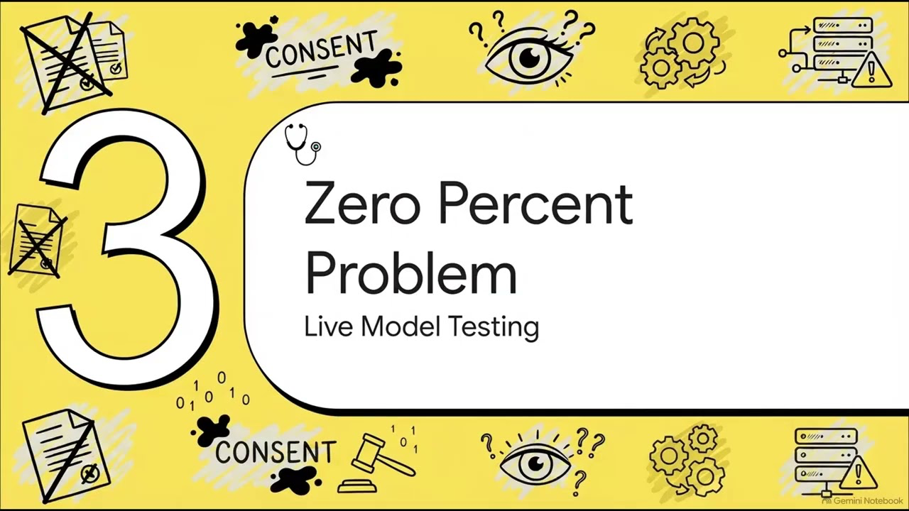

<div align="center">


### A FHIR-consent scope gate, AI-disclosure stamper, and signed competency gate for clinical AI agents


[](https://huggingface.co/datasets/Quome/consentbench)

[**Quickstart**](#quickstart) · [How it works](#how-it-works) · [Reproduce](#reproduce-the-experiments) · [Results](#headline-results) · [Paper](papers/013-consent/main.pdf) · [Dataset](https://huggingface.co/datasets/Quome/consentbench) · [Cite](#cite)

</div>

---

An agent action can be authorized and clinically correct and still be unlawful: taken outside the patient's recorded consent, or delivered as a patient-facing message that hides its AI authorship. The consent layer runs in the qfire gateway after identity (quorum) and policy (quwarden): it resolves each action against a FHIR-Consent-shaped directive (default-deny, most-specific-match; withdrawn/expired/missing consent escalates to human review, an explicit deny is a hard block), stamps a canonical AI-involvement disclosure onto patient-facing output, requires an ed25519-signed operator attestation for credentialed actions, flags goals-of-care conflicts, and anchors participatory-governance inputs to the quledger audit chain. On a live llama3.1:8b gateway, spontaneous AI disclosure on 120 patient-facing messages is 0% and the un-gated gateway proceeds on 100% of the 22 withdrawn/expired/out-of-scope cases; the layer lifts disclosure to 100% (McNemar p < 1e-4) and cuts out-of-scope action to 0%, at 2.409 us per decision.

<div align="center">

[](https://youtu.be/QxtS1_6gstU)

**▶ Watch: [Quconsent: Consent and Disclosure Enforcement for Clinical AI Agents (talk)](https://youtu.be/QxtS1_6gstU)**

</div>

`quconsent` is **a module of the QUOKKAGUARD program**: one Rust security gateway (`qfire`) that sits in front of any OpenAI-compatible model endpoint and decides **ALLOW ▸ forward · BLOCK ▸ refuse · ESCALATE ▸ human review** for every request and response. Each module adds exactly one enforcement layer to that gateway plus one adversarial dataset and one paper. This repository is a self-contained snapshot of the gateway with **this layer** (`src/consent/`, on the *response/admission* path, HAARF control C4), its dataset (**ConsentBench**), the experiment harness, and the paper.

> **Needs a local model for some experiments.** Live runs go through [Ollama](https://ollama.com) on the OpenAI-compatible endpoint; no paid API keys are used anywhere in this repo.

## How it works

- **Consent scope gate (G1)**: each action is resolved against a FHIR-Consent-shaped directive (lifecycle status, default base stance, purpose-scoped permit/deny exceptions with optional action lists) using default-deny, most-specific-match resolution where ties favour deny; a non-active directive (withdrawn, expired, draft) cannot authorize anything and escalates.
- **Three-way effect, never a silent allow**: the layer returns Allow, Deny, or Escalate. An explicit deny-provision or unsupported purpose is a hard Deny; consent in doubt (withdrawn, expired, missing, unverified), a competency gap, or a goals-of-care conflict is an Escalate routed to human review through the qutriage oversight layer.
- **Disclosure attacher (G2)**: a simple auditable detector scores three cues (AI/automated authorship, human-clinician oversight, a way to reach a human or opt out); the response-path attacher stamps a canonical disclosure onto any patient-facing message lacking one and never double-stamps. The same detector is the measurement instrument for the live E1 study.
- **Competency gate (G3)**: credentialed action classes (controlled-substance orders, chemotherapy, final diagnosis) require an OperatorAttestation whose ed25519 signature over operator identity and credential set is verified against the operator's registered key; unsigned, mis-signed, missing, or under-credentialed operators escalate, and post-signing credential tampering fails verification.
- **Goals-of-care flagger (G4) and governance ledger (G5)**: a scored conflict check escalates at a clinician-tunable threshold (falling back to a contraindication map against recorded values such as DNR or no-blood-products); an append-only SHA-256 hash-chained ledger records community reviews and advisory sign-offs with its head hash anchored into the quledger audit chain, so any retroactive edit breaks verification.

## Quickstart

Requires Rust 1.85+ (`rustup`), Python 3.10+ for the analysis scripts, and `tectonic` (or `pdflatex`) only if you want to rebuild the paper.

```bash
git clone https://github.com/quome-cloud/quconsent
cd quconsent
cargo build --release
cargo test consent   # this layer's tests
```

Then see the layer in action:

```bash
# 1. Consent-scope enforcement (E2): 712 scenarios against 200 FHIR-consent directives, no model needed
cargo run --release --bin consentrun -- e2 \
  --scenarios datasets/013-consent/consentbench/scenarios.jsonl \
  --directives datasets/013-consent/consentbench/consent_directives.jsonl \
  --out results/013-consent/e2_enforcement.json
# wrote results/013-consent/e2_enforcement.json   (CVP 100%, in-scope false-block 0%)

# 2. Disclosure coverage (E3): bare vs stamped patient-facing messages, offline
cargo run --release --bin consentrun -- e3 \
  --pf datasets/013-consent/consentbench/patient_facing.jsonl \
  --out results/013-consent/e3_disclosure.json
# wrote results/013-consent/e3_disclosure.json    (coverage 0% -> 100%, ~3.8us per message)

# 3. Competency gate (E4): forged / missing / under-credentialed operators, offline
cargo run --release --bin consentrun -- e4 \
  --scenarios datasets/013-consent/consentbench/scenarios.jsonl \
  --directives datasets/013-consent/consentbench/consent_directives.jsonl \
  --out results/013-consent/e4_competency.json
# wrote results/013-consent/e4_competency.json    (CGP 100%, friction 0%)

# 4. (Optional, needs local Ollama with llama3.1:8b) the live disclosure gap, E1
# cargo run --release --bin consentrun -- e1 --pf datasets/013-consent/consentbench/patient_facing.jsonl \
#   --directives datasets/013-consent/consentbench/consent_directives.jsonl --out results/013-consent/e1_live.json --model llama3.1:8b
```

## Reproduce the experiments

Every number in the paper traces to one of these runs (95% Wilson CIs, deterministic seeds, pinned model snapshots). Run outputs land in `results/013-consent/` (not tracked; see [`results/013-consent/README.md`](results/013-consent/README.md) for the exact regeneration commands).

| Exp | What it measures | Needs |
|---|---|---|
| E1 | Live disclosure + out-of-scope-action gap: un-gated vs gated gateway on 120 patient-facing prompts (McNemar) | ollama |
| E2 | G1 consent-scope enforcement: violation-prevention rate and in-scope false-block rate, no-gate vs gate | offline |
| E3 | G2 disclosure coverage: bare vs attacher-stamped output, per-message latency, no double-stamping | offline |
| E4 | G3 competency gating: prevention of missing/uncredentialed/forged operator actions and friction on valid ones | offline |
| E5 | G4 goals-of-care detection: threshold sweep of TPR vs false-block over 300 scored cases, Cohen's kappa | offline |
| E6 | Overhead: per-decision latency and throughput of the full layer | offline |
| figures | Regenerate every figure and numbers.tex from results/013-consent/*.json | offline |

```bash
# E1 — Live disclosure + out-of-scope-action gap: un-gated vs gated gateway on 120 patient-facing prompts (McNemar)
cargo run --release --bin consentrun -- e1 --pf datasets/013-consent/consentbench/patient_facing.jsonl --directives datasets/013-consent/consentbench/consent_directives.jsonl --out results/013-consent/e1_live.json --model llama3.1:8b

# E2 — G1 consent-scope enforcement: violation-prevention rate and in-scope false-block rate, no-gate vs gate
cargo run --release --bin consentrun -- e2 --scenarios datasets/013-consent/consentbench/scenarios.jsonl --directives datasets/013-consent/consentbench/consent_directives.jsonl --out results/013-consent/e2_enforcement.json

# E3 — G2 disclosure coverage: bare vs attacher-stamped output, per-message latency, no double-stamping
cargo run --release --bin consentrun -- e3 --pf datasets/013-consent/consentbench/patient_facing.jsonl --out results/013-consent/e3_disclosure.json

# E4 — G3 competency gating: prevention of missing/uncredentialed/forged operator actions and friction on valid ones
cargo run --release --bin consentrun -- e4 --scenarios datasets/013-consent/consentbench/scenarios.jsonl --directives datasets/013-consent/consentbench/consent_directives.jsonl --out results/013-consent/e4_competency.json

# E5 — G4 goals-of-care detection: threshold sweep of TPR vs false-block over 300 scored cases, Cohen's kappa
cargo run --release --bin consentrun -- e5 --goals datasets/013-consent/consentbench/goals_of_care.jsonl --out results/013-consent/e5_goals.json

# E6 — Overhead: per-decision latency and throughput of the full layer
cargo run --release --bin consentrun -- e6 --scenarios datasets/013-consent/consentbench/scenarios.jsonl --directives datasets/013-consent/consentbench/consent_directives.jsonl --out results/013-consent/e6_overhead.json

# figures — Regenerate every figure and numbers.tex from results/013-consent/*.json
python3 scripts/013-consent/summarize.py
```

**Dataset — ConsentBench** (`datasets/013-consent/`): Four deterministic JSONL corpora under consentbench/: 200 FHIR-Consent-shaped directives, 712 scope/competency scenarios (in-scope, out-of-scope, explicit-deny, withdrawn, expired, draft; missing/uncredentialed/forged operators) with expected gateway behavior, 120 patient-facing prompts tagged with consent status, and 300 scored goals-of-care cases with two synthetic clinician raters; seed 42, no PHI.

Regenerate the corpus (deterministic seeds):

```bash
python3 scripts/013-consent/gen_consent.py
```

The corpus is also published as a Hugging Face dataset with a full data card: **[Quome/consentbench](https://huggingface.co/datasets/Quome/consentbench)** (`datasets.load_dataset("Quome/consentbench")`, or `hf download Quome/consentbench --repo-type dataset`).

All data are synthetic; no protected health information is used anywhere in this repository.

## Headline results

| Metric | Value | Context |
|---|---|---|
| Spontaneous AI-involvement disclosure (live llama3.1:8b, n=120) | **0.0% un-gated -> 100.0% gated** | 120 discordant pairs, McNemar p < 1e-4; reproduced exactly with gpt-oss:120b |
| Out-of-scope action on withdrawn/expired/out-of-scope consent (live) | **100.0% un-gated -> 0.0% gated** | 22 forbidden-contact cases, every one escalated by the scope gate |
| Consent-scope violation prevention (E2) | **100.0% prevented, 0.0% in-scope false-block** | 311 violation cases, 289 in-scope cases |
| Competency gating (E4) | **100.0% of unqualified credentialed actions stopped, 0.0% friction** | 74 should-stop cases incl. forged and post-signing tampered attestations |
| Goals-of-care detection (E5) | **98.5% TPR at 0.0% false-block (kappa 0.61)** | 300 scored cases at the default threshold |
| Overhead (E6) | **2.409 us per decision (~0.4M decisions/s)** | 356,000 decisions through scope + goals-of-care + disclosure; disclosure alone 3.79 us/message |

Full methodology, ablations, and statistics: **[the paper](papers/013-consent/main.pdf)**.

## The paper

**Consent Is a Gateway Responsibility: Enforcing Patient Consent, AI Disclosure, and Participatory Governance for Clinical AI Agents**

- PDF: [`papers/013-consent/main.pdf`](papers/013-consent/main.pdf)
- Source: [`papers/013-consent/`](papers/013-consent/) — `main.tex`, `numbers.tex` (every headline macro, generated by the scripts above), `figs/`, `refs.bib`
- Pre-registered proposal (threat model, hypotheses, experiment→figure map): [`papers/013-consent/PROPOSAL.md`](papers/013-consent/PROPOSAL.md)
- Rebuild: `cd papers/013-consent && make paper` (tectonic, or pdflatex + bibtex)

## Repository layout

| Path | What |
|---|---|
| `src/` | The `qfire` gateway crate. This paper's layer lives in `src/consent/`; the other modules are the always-on baseline it plugs into. |
| `src/bin/` | CLI (`qfire`) and per-paper experiment harnesses |
| `rules/`, `chains/` | Declarative rule and detector-chain library used by the gateway |
| `datasets/013-consent/` | ConsentBench (also on Hugging Face: [Quome/consentbench](https://huggingface.co/datasets/Quome/consentbench)) |
| `scripts/013-consent/` | Dataset generator, experiment runners, figure and `numbers.tex` builders |
| `scripts/common/` | Shared helpers |
| `papers/013-consent/` | The paper (LaTeX + PDF + proposal) |
| `results/013-consent/` | Experiment outputs (see above) |
| `tests/`, `benches/` | Integration tests and Criterion benches |
| `SNAPSHOT.md` | Which `quokkaguard` commit this repo was exported from |

## Relationship to QUOKKAGUARD

This repo is a **snapshot** of the QUOKKAGUARD program's gateway (export `1c04c3a34841`, 2026-10-02), filtered to the `quconsent` module. The full `qfire` crate is included so this layer builds, tests, and runs standalone; the other modules are the always-on baseline the layer plugs into. Issues and pull requests are welcome here.

This layer builds on: [quwarden](https://github.com/quome-cloud/quwarden), [quledger](https://github.com/quome-cloud/quledger), [quorum](https://github.com/quome-cloud/quorum), [qutriage](https://github.com/quome-cloud/qutriage).

Sibling repos in the series: [quanchor](https://github.com/quome-cloud/quanchor), [quledger](https://github.com/quome-cloud/quledger), [qubom](https://github.com/quome-cloud/qubom), [quwarden](https://github.com/quome-cloud/quwarden), [qudam](https://github.com/quome-cloud/qudam), [quantidote](https://github.com/quome-cloud/quantidote), [quorum](https://github.com/quome-cloud/quorum), [qutriage](https://github.com/quome-cloud/qutriage), [qufair](https://github.com/quome-cloud/qufair), [qudrift](https://github.com/quome-cloud/qudrift), [qupassport](https://github.com/quome-cloud/qupassport), [qubroker](https://github.com/quome-cloud/qubroker), [qusiege](https://github.com/quome-cloud/qusiege).

## Cite

If you use this code or dataset, cite the paper and the HAARF framework it implements:

```bibtex
@unpublished{schwoebel2026quconsent,
  author = {{QUOKKAGUARD Working Group}},
  title  = {Consent Is a Gateway Responsibility: Enforcing Patient Consent, AI Disclosure, and Participatory Governance for Clinical AI Agents},
  note   = {Preprint. Quome, QUOKKAGUARD program (quconsent module)},
  year   = {2026},
  url    = {https://github.com/quome-cloud/quconsent}
}

@unpublished{schwoebel2026haarf,
  author = {Schwoebel, Jim and Frasch, Martin and Spalding, Art and Sewell, Ed and Englert, Phil and Halpert, Ben and Overbay, Collin and Semenec, Ingrida and Shor, Joel},
  title  = {{HAARF}: Healthcare {AI} agents regulatory framework --- a comprehensive security verification standard for autonomous {AI} systems in clinical environments},
  note   = {medRxiv Preprint},
  year   = {2026},
  month  = {April},
  doi    = {10.64898/2026.04.09.26350519},
  url    = {https://www.medrxiv.org/content/10.64898/2026.04.09.26350519v1}
}
```

## Status

Research prototype. It demonstrates the layer end to end with reproducible experiments; it is not a certified medical device or a production security product. Threat-model boundaries and known gaps are in the paper's Discussion.

## License

Apache License 2.0 — see [LICENSE](LICENSE). Copyright (c) 2026 Quome, Inc.
